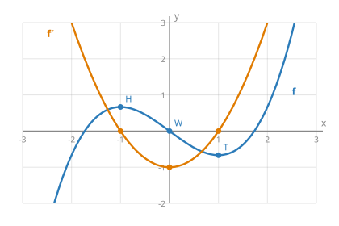

## Worum es geht

Die **Ableitungsfunktion** $f'$ ordnet jeder Stelle $x$ die Steigung des Graphen von $f$ an dieser Stelle zu. Man kann ihren Graphen skizzieren, ohne einen Term zu kennen, nur indem man die Steigungen von $f$ abliest. Das heißt **grafisches Ableiten**. In Klausuren kommt es oft als Zuordnungs- oder Begründungsaufgabe vor.

## Steigung ablesen

An einer Stelle $a$ legst du ein Lineal so an, dass es den Graphen in $P(a \mid f(a))$ nur berührt (Tangente). Mit einem Steigungsdreieck an dieser Tangente liest du $f'(a)$ ab. Das ist ein Schätzwert, Genauigkeit auf etwa eine halbe Einheit reicht.

## Die wichtigsten Zusammenhänge

| Am Graphen von $f$ sieht man … | … daraus folgt für den Graphen von $f'$ |
|---|---|
| $f$ steigt | $f'(x) > 0$, Graph von $f'$ **oberhalb** der x-Achse |
| $f$ fällt | $f'(x) < 0$, Graph von $f'$ **unterhalb** der x-Achse |
| waagerechte Tangente | $f'(x) = 0$, **Nullstelle** von $f'$ |
| Hoch- oder Tiefpunkt | Nullstelle von $f'$, bei der $f'$ das Vorzeichen wechselt (Graph **schneidet** die x-Achse) |
| Sattelpunkt (waagerecht, aber kein Extrempunkt) | Nullstelle von $f'$ **ohne** Vorzeichenwechsel (Graph **berührt** die x-Achse) |
| Stelle, an der $f$ am steilsten bzw. am flachsten ist (Wendestelle) | **Extremstelle** von $f'$ (Hoch- oder Tiefpunkt von $f'$) |
| $f$ sehr steil | $f'$ hat einen großen Betrag, Graph weit weg von der x-Achse |
| $f$ ist um $d$ nach oben verschoben | $f'$ ändert sich **nicht** |

Außerdem: Ist $f$ ganzrational vom Grad $n$, dann ist $f'$ vom Grad $n - 1$. Aus einer Parabel wird also eine Gerade, aus einer kubischen Funktion eine Parabel.

## Beispiel

- $f$ hat bei $x = -1$ einen Hochpunkt und bei $x = 1$ einen Tiefpunkt. Also hat $f'$ dort Nullstellen.
- Links von $-1$ und rechts von $1$ steigt $f$: $f'$ ist positiv. Dazwischen fällt $f$: $f'$ ist negativ.
- Bei $x = 0$ fällt $f$ am steilsten (Wendepunkt W). Dort hat $f'$ seinen Tiefpunkt.

## Vorgehen beim grafischen Ableiten

1. Stellen mit **waagerechter Tangente** markieren. Das sind die Nullstellen von $f'$.
2. Bereiche, in denen $f$ steigt oder fällt, bestimmen. Daraus folgt das **Vorzeichen** von $f'$.
3. Stellen mit **größter oder kleinster Steigung** (Wendestellen) suchen. Dort hat $f'$ Extrempunkte.
4. An einigen Stellen die Steigung mit Tangente und Steigungsdreieck **schätzen** und eintragen.
5. Die Punkte zu einer glatten Kurve verbinden.

## Umgekehrt: von f′ auf f schließen

Ist nur der Graph von $f'$ gegeben, liest man ab: Wo $f'$ positiv ist, steigt $f$. Wo $f'$ mit Vorzeichenwechsel von $+$ nach $-$ die x-Achse schneidet, hat $f$ einen Hochpunkt, bei $-$ nach $+$ einen Tiefpunkt. Achtung: Die **Höhe** des Graphen von $f$ kann man aus $f'$ nicht ablesen. Man kennt $f$ nur bis auf eine Verschiebung nach oben oder unten.
